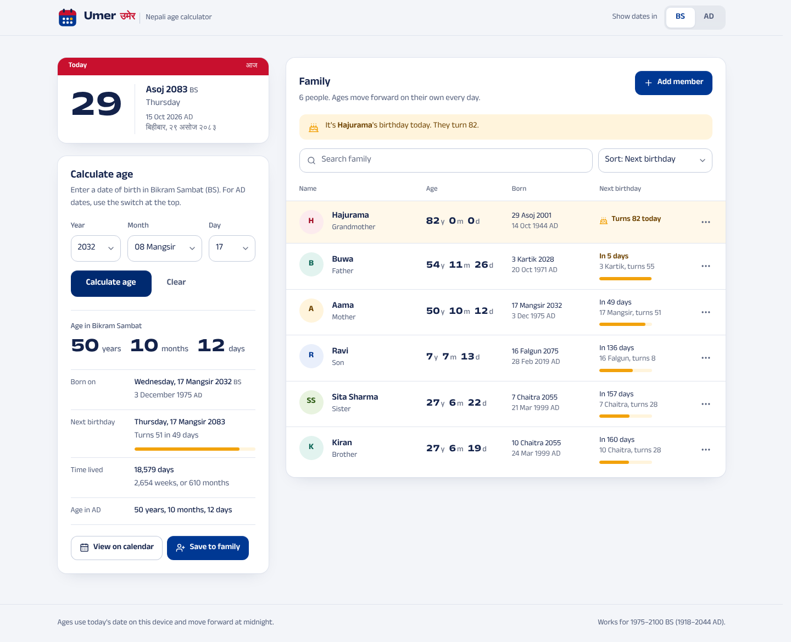
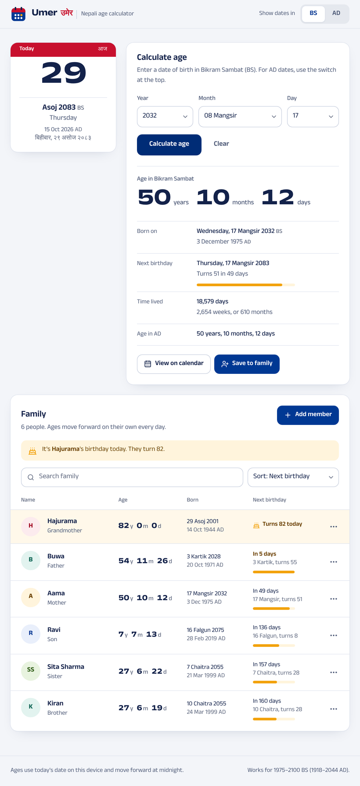
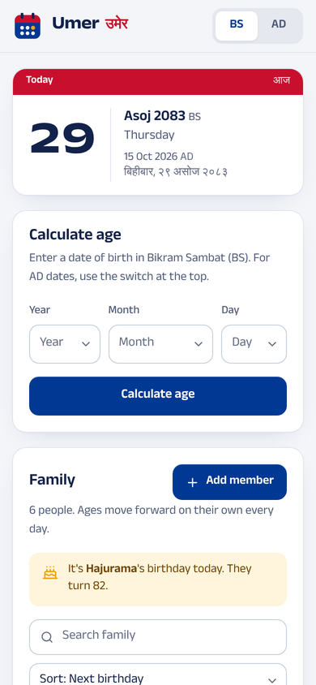
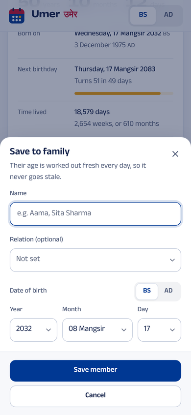

# Umer — Nepali age calculator (BS & AD)

**Umer** (उमेर, "age") is a MERN app that works out exact ages in **Bikram Sambat (BS)** or **Gregorian (AD)** dates and keeps a family list whose ages move forward on their own, day by day.



| Tablet | Phone | Saving a family member |
| --- | --- | --- |
|  |  |  |

## Features

- **BS / AD switch** in the header changes the whole app; the choice is remembered on the device. Every date is also shown in the other calendar.
- **Date pickers that follow the real calendars**: BS months of 29–32 days, AD leap years. Dates after today can't be picked.
- **Exact age** in years, months and days, with the weekday of birth, a countdown to the next birthday, days lived, and the same age in the other calendar.
- **Patro-style month view**: BS day numbers with AD underneath (or the reverse), Saturdays in red, the birth date and later birthdays marked.
- **Family list in MongoDB**: add, edit and delete as many people as you like; search; sort by next birthday, name, age or date added.
- **Ages stay current**: ages are never stored. They are worked out from the birth date, so they move forward every day, and an open tab rolls over at midnight without a reload.
- Birthday-today and upcoming-birthday highlights.
- Responsive from 320px phones to wide desktops, keyboard and screen-reader friendly, WCAG AA contrast (checked with axe-core). Can be added to a phone's home screen.

## Tech stack

| Part | Stack |
| --- | --- |
| Client | React 19, Vite 8, Tailwind CSS 4, TanStack Query, lucide-react, sonner |
| Server | Node.js, Express 5, Mongoose 9 (MongoDB), Zod, Helmet, express-rate-limit |
| Shared | `@umer/shared` — the BS calendar data, BS ⇄ AD conversion and age maths, used by both client and server |

It is an npm-workspaces monorepo, so one `npm install` sets up everything.

## Getting started

**You need:** Node.js 20.19 or newer (22 LTS recommended) and MongoDB.

```bash
npm install
cp server/.env.example server/.env     # Windows: copy server\.env.example server\.env
npm run dev
```

Open **http://localhost:5173**. The API runs on http://localhost:5050; Vite forwards `/api` requests to it.

**MongoDB**, any one of:

- MongoDB Community Server running locally — the default `MONGODB_URI` works as is.
- Docker: `docker compose up -d` starts one with the included `docker-compose.yml`.
- MongoDB Atlas: put your connection string in `MONGODB_URI` in `server/.env`.

If MongoDB isn't running, the API still starts, keeps retrying, and the app shows a clear message; the calculator itself keeps working.

**Try it on your phone:** run `npm run dev:lan` and open the "Network" address Vite prints, on a phone connected to the same Wi-Fi.

## Scripts (run from the project root)

| Command | What it does |
| --- | --- |
| `npm run dev` | API (restarts on changes) and the Vite dev server together |
| `npm run dev:lan` | The same, reachable from other devices on your network |
| `npm test` | Calendar and age unit tests, then API tests (API tests need MongoDB and skip themselves without it) |
| `npm run build` | Builds the client into `client/dist` |
| `npm start` | Runs the API; when `client/dist` exists it serves the app too |
| `npm run lint` | ESLint for the client |

## Production

```bash
npm run build
npm start
```

That runs everything as one service on `PORT` (5050 by default): the API under `/api` and the built React app for every other path. Set `NODE_ENV=production` in `server/.env` for production logging and a stricter CORS policy. To host the client separately, set `VITE_API_URL` when building it and add its origin to `CLIENT_ORIGIN`.

## Configuration

`server/.env`

| Variable | Default | Meaning |
| --- | --- | --- |
| `PORT` | `5050` | Port for the API (and the built app) |
| `MONGODB_URI` | `mongodb://127.0.0.1:27017/nepali_age_calculator` | MongoDB connection string |
| `APP_TIME_ZONE` | `Asia/Kathmandu` | Time zone the API uses for "today" in the ages it returns |
| `CLIENT_ORIGIN` | — | Extra allowed origins, comma-separated, if the client is hosted elsewhere |
| `NODE_ENV` | `development` | `production` for compact logs and no localhost CORS |
| `SERVE_CLIENT` | `true` | Set to `false` to stop the API serving `client/dist` |

`client/.env` (optional)

| Variable | Default | Meaning |
| --- | --- | --- |
| `VITE_API_URL` | `/api` | API base URL as seen by the browser |
| `API_PROXY_TARGET` | `http://localhost:5050` | Where `npm run dev` forwards `/api` |

## API

All responses are JSON. Errors look like `{ "message": "...", "fieldErrors": { "dob": "..." } }` with status 400, 404 or 503.

| Method | Path | Notes |
| --- | --- | --- |
| `GET` | `/api/health` | Database status and today's date in both calendars |
| `GET` | `/api/members` | Query: `q` (name or relation), `sort` = `recent` · `name` · `oldest` · `youngest` · `birthday`, `calendar` = `BS` · `AD` (for `birthday`) |
| `GET` | `/api/members/:id` | One member |
| `POST` | `/api/members` | Body: `{ "name", "relation"?, "calendar": "BS" \| "AD", "dob": "YYYY-MM-DD" }` → 201 |
| `PUT` | `/api/members/:id` | Same body as `POST` |
| `DELETE` | `/api/members/:id` | 204 |

```bash
curl -X POST http://localhost:5050/api/members \
  -H "Content-Type: application/json" \
  -d '{"name":"Aama","relation":"Mother","calendar":"BS","dob":"2032-08-17"}'
```

```json
{
  "asOf": { "ad": "2026-10-15", "bs": "2083-06-29", "timeZone": "Asia/Kathmandu" },
  "member": {
    "id": "6ad01c5e71f9c0703cf8dea7",
    "name": "Aama",
    "relation": "Mother",
    "dob": { "ad": "1975-12-03", "bs": "2032-08-17" },
    "enteredIn": "BS",
    "age": {
      "totalDays": 18579,
      "bs": { "years": 50, "months": 10, "days": 12, "isBirthdayToday": false,
              "birthday": { "date": "2083-08-17", "daysUntil": 49, "turning": 51 } },
      "ad": { "years": 50, "months": 10, "days": 12, "isBirthdayToday": false,
              "birthday": { "date": "2026-12-03", "daysUntil": 49, "turning": 51 } }
    },
    "createdAt": "2026-10-15T00:20:46.597Z",
    "updatedAt": "2026-10-15T00:20:46.597Z"
  }
}
```

## How ages stay correct

- **What's stored:** the birth date as plain `YYYY-MM-DD` text in both calendars, never as a timestamp, so it can't shift by a day between time zones.
- **What isn't:** the age. The browser works it out from the device's date and re-renders at local midnight (and when a sleeping tab wakes up). The API works it out on every request using `APP_TIME_ZONE`.
- **The rule:** count whole years, then whole months, then the remaining days. A birthday that doesn't exist in a given month (32 Asar in a 31-day Asar, 29 February in a common year) falls on that month's last day, so on every birthday the age reads exactly *N years, 0 months, 0 days*.
- The BS and AD breakdowns can differ by a few days because the months have different lengths; the total number of days is always the same.

## Bikram Sambat calendar data

BS has no formula — month lengths come from published calendars. `shared/src/bsData.js` covers **1975–2100 BS (13 April 1918 – 12 April 2044 AD)**. The table follows the dataset maintained by opensource-nepal (`nepali-datetime`, MIT), cross-checked against six other open datasets and spot-checked against Hamro Patro. Years up to 2084 match published calendars; later years are projections. When a new year's official calendar is out, update its row and run `npm test` — the tests check every row and a list of known dates (national days, new years, and the `2032 Mangsir 17 → 50 years 10 months 12 days` example).

## Project structure

```
├── client/                React + Vite + Tailwind app
│   ├── public/            favicon, home-screen icons, web manifest
│   └── src/
│       ├── components/    AgeCalculator, FamilyPanel, MemberRow, CalendarDialog, MemberDialog, …
│       │   └── ui/        Button, Dialog (native <dialog>), form fields
│       ├── hooks/         useMembers (TanStack Query), useCountUp
│       ├── lib/           API client, picker and list helpers
│       └── state/         calendar mode, live "today", saved-row highlight
├── server/                Express + Mongoose API
│   ├── src/
│   │   ├── config/        environment, MongoDB connection with retry
│   │   ├── controllers/   members CRUD
│   │   ├── models/        Member schema
│   │   ├── middleware/    error handling, database readiness
│   │   ├── validation/    request validation (Zod + calendar checks)
│   │   └── lib/           response shaping (live ages)
│   └── test/              API tests (node:test + supertest)
├── shared/                @umer/shared: BS data, conversion, age maths, formatting
│   └── test/              unit tests (node:test)
├── docs/screenshots/
└── docker-compose.yml     optional local MongoDB
```

## Good to know

- There is **no login**: everyone who can open the app sees and edits the same family list. That suits a family on a home network or a private deployment; add authentication before putting it on the public internet.
- "Today" in the browser is the device's local date, so a relative abroad sees ages roll over at their own midnight.
